# Hey Sam Pulse

A dashboard concept for Hey Sam, the peer-to-peer text support line run by Samaritans. Built for the Hack4Impact BU Buildathon, September 2026.

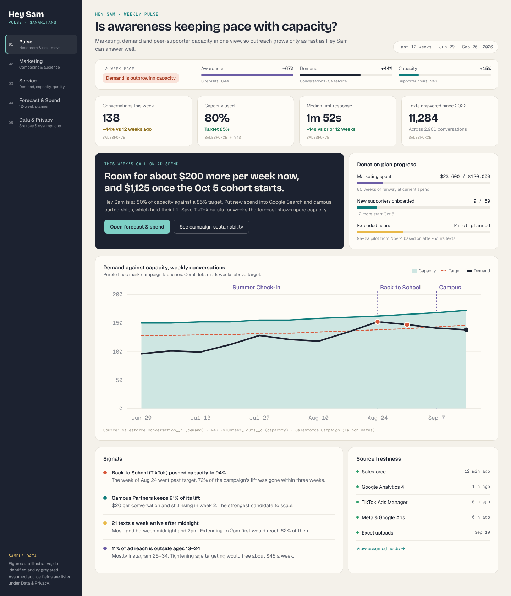

## The problem

Hey Sam is a text line for young people, answered by trained peer supporters close to their age. Samaritans wants more young people to know it exists. But every new texter needs a supporter on the other end. If marketing works too well, people wait, or text when nobody can answer.

Samaritans asked for a dashboard that pulls together Salesforce, Google Analytics, social media and Excel data. It needed to help them grow awareness at the same pace as volunteer capacity, include survey feedback and demographics, and protect texters' privacy.

## The idea

Most marketing dashboards ask "did the campaign work?" This one asks "are we ready for the next person who reaches out?"

So the dashboard works like a throttle, not a scoreboard. It compares demand against how many conversations supporters can actually handle. Then it tells the team how much more they can spend on ads this week without going over capacity.

## What's in it

The mockup has five tabs.

| Tab | What it answers |
| --- | --- |
| **01 Pulse** | Is awareness keeping pace with capacity? Shows demand against capacity, this week's ad spend call, and the signals worth acting on. |
| **02 Marketing** | Which campaigns bring lasting demand, and who do they reach? Ranks each campaign as Scale, Hold or Burst only, based on cost per conversation and how much of its lift sticks after six weeks. |
| **03 Service** | When do texts arrive and who answers? Covers texts that come in after hours, shift coverage, the supporter pipeline, supporter wellbeing and post-chat survey results. |
| **04 Forecast & Spend** | What happens if we change spend, recruiting or service hours? An interactive 12-week planner. Move the sliders and the forecast updates. |
| **05 Data & Privacy** | What comes in from each source, what never does, and which fields the design assumes exist. |

More screenshots

### Marketing
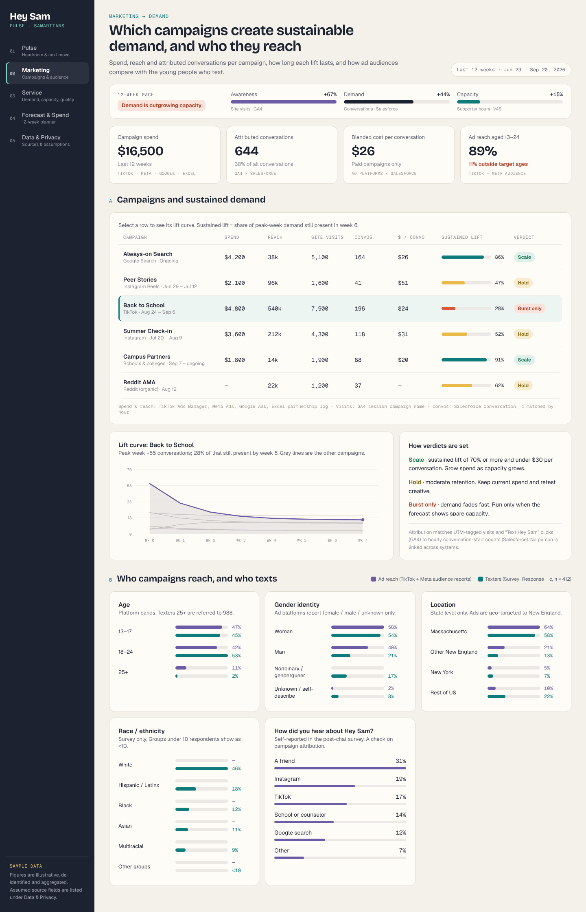

### Service
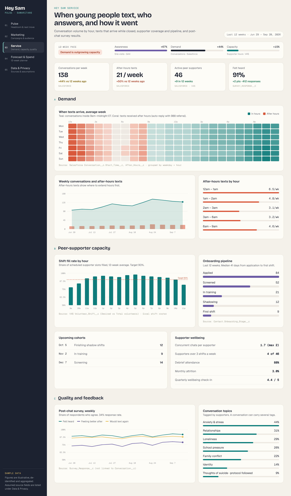

### Forecast & Spend
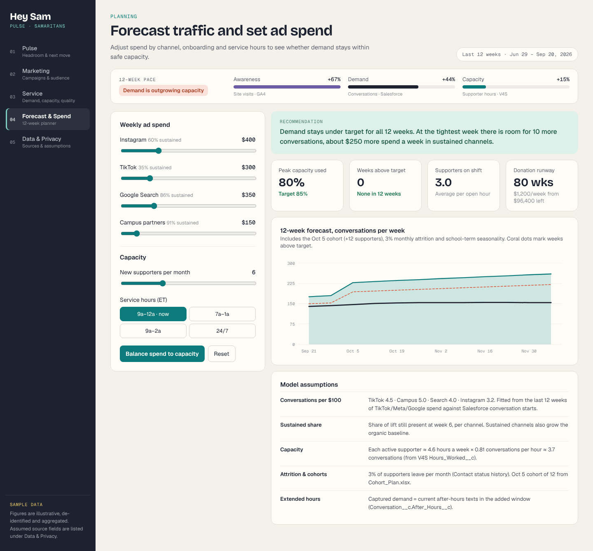

### Data & Privacy
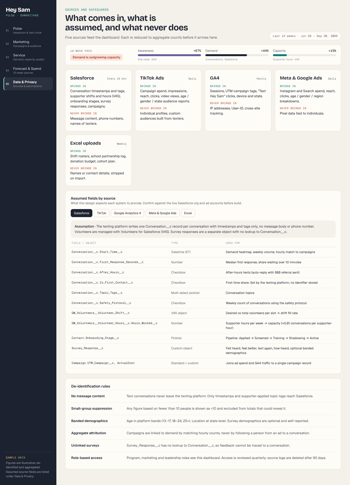

## Early warnings

Three signals most dashboards miss:

- **News surges.** Separates news-driven demand from campaign lift. A surge gets more staff, never more ads.
- **Awareness-to-connection lag.** Shows when a campaign's demand will actually arrive, so shifts are ready first.
- **The peer flywheel.** Tracks volunteer recruiting next to demand, so capacity grows with reach.

## Privacy by design

Texters are young people, sometimes in crisis. So privacy is built into the data pipeline, not added as a policy on top. Data is cut down to counts before it ever reaches the dashboard.

- **No message content.** Conversations never leave the texting platform. Only timestamps and topic tags reach Salesforce.
- **Small groups are hidden.** Any figure based on fewer than 10 people shows as `<10`.
- **No following people.** Campaigns are linked to demand by matching hourly counts, never by tracking a person from an ad to a conversation.
- **Surveys stay unlinked.** Survey responses have no link to a conversation, so feedback can't be traced back.
- **Banded demographics.** Age in bands, location at state level only.

The full list of sources, assumed Salesforce fields and rules is in [docs/data-model.md](docs/data-model.md).

## How the forecast works

The planner uses a simple model, fitted to the last 12 weeks of sample data.

- **Demand** = baseline + (spend per channel × conversations per $100 for that channel). Channels whose lift lasts also grow the baseline over time.
- **Capacity** = active supporters × about 4.6 hours a week × about 0.81 conversations per hour, or roughly 3.7 conversations per supporter per week.
- **Supporters** change with new cohorts and about 3% leaving each month.
- **Target** is 85% of capacity. Weeks above it are flagged.

## Status

This is a design mockup, not a working product.

- All numbers are **made-up sample data**.
- Nothing connects to a real Salesforce org or ad account.
- The Salesforce fields are **assumptions** about how Samaritans' system is set up. They would need to be checked before a real build.

## If it were built for real

The pitch was "start Monday, with tools you already have."

1. **First 30 days, $0.** One number, weekly. A Salesforce report, a free Looker Studio dashboard, and a 30-minute review.
2. **Months 2–3.** Add the signals: news alerts, survey trends, volunteer check-ins and a weekly summary.
3. **As capacity grows.** Plan ahead with the planning simulator, recruitment tracking and language matching.

Owner: Hey Sam text operations, about 1–2 hours a week after setup.

## Pitch deck

The 10-slide deck we presented: [PDF](docs/pitch/HeySam-Connection-Pulse.pdf) · [PowerPoint](docs/pitch/HeySam-Connection-Pulse.pptx)

| | |
| --- | --- |
| 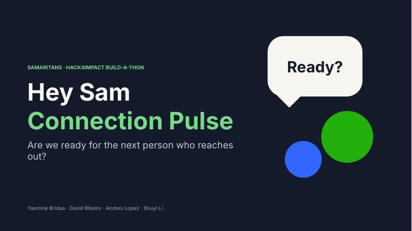 | 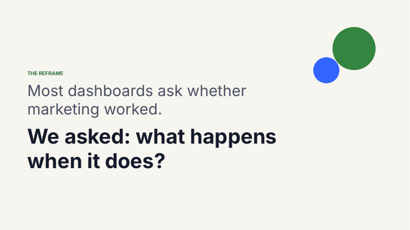 |
| 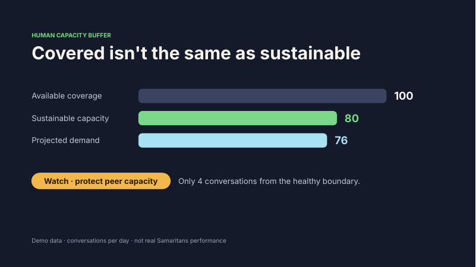 | 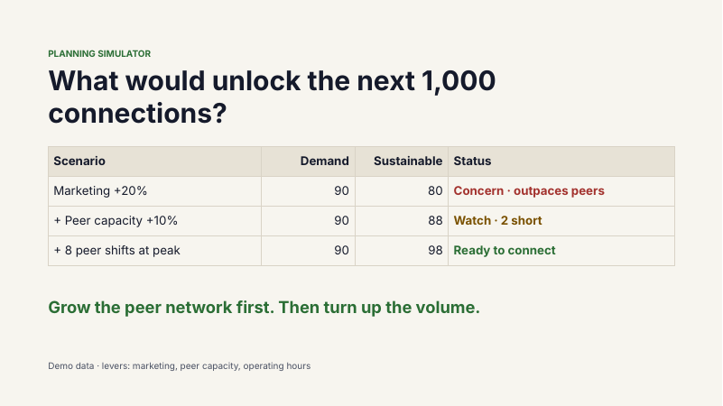 |

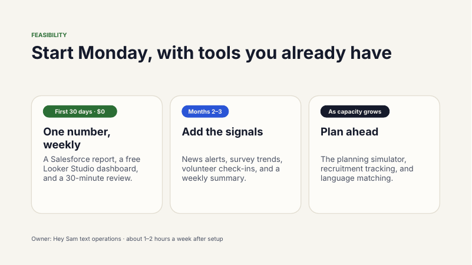

## How it evolved

The first concept was called **Growth Control Tower**. It was built around one question, "Can we grow right now?", with a safe-growth signal, news watch, campaign impact and a staffing unlock. We pitched it as **Connection Pulse**, and the final mockup is **Hey Sam Pulse**.

First concept: Growth Control Tower

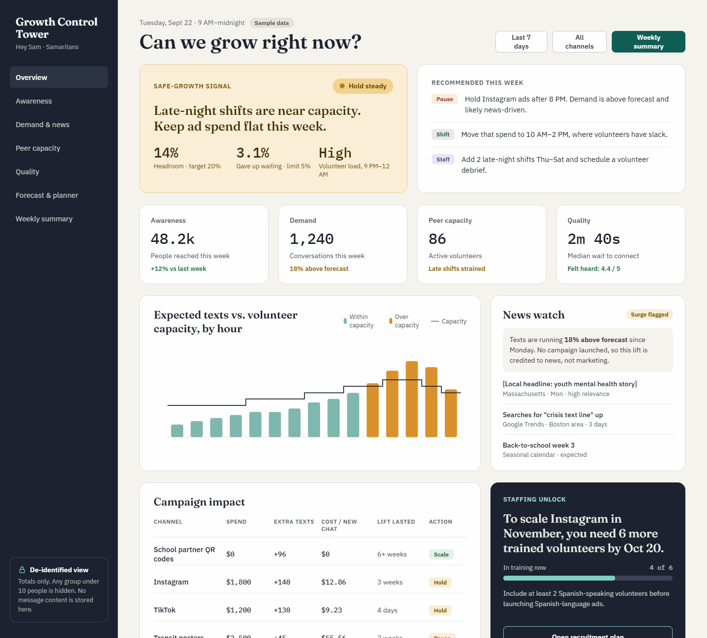

## Running it

It's a single self-contained HTML file with no build step. Download `index.html` and open it in any browser.

## Built with

The mockup and deck were designed and built with Claude during the buildathon. The mockup is bundled into one HTML file with no outside dependencies.

## Team

Built for the Samaritans × Hack4Impact BU Buildathon by:

- Yasmine Bridaa
- [David Ribeiro](https://github.com/dribeiro0)
- Andres Lopez
- Shuyi Li

Hey Sam and the Samaritans name belong to Samaritans. This project is not affiliated with or endorsed by them.
